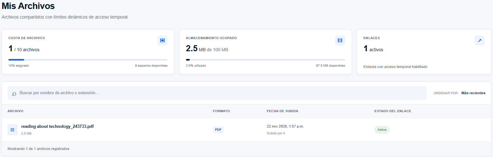

<p align="center">
  
</p>

# SafeLinK

Aplicación web para compartir archivos mediante enlaces temporales con contraseña opcional, límite de descargas y revocación. El propietario administra sus archivos y el servidor comprueba las condiciones antes de entregar el contenido.



## Aplicación y demostración

- [Aplicación web](https://safelink-frontend-lyart.vercel.app/registro)
- [Video del proyecto](https://drive.google.com/file/d/1xVF5FNJLkUk7PY_AOp1JlFMwMIbw6Oju/view?usp=drive_link)
- [Repositorio](https://github.com/KarolinaTrujillo/SafeLinK)
- [Video demostrativo](https://drive.google.com/file/d/1h8Ba0OZDu4CzVCZDntW92X-EPOhsY-vA/view?usp=sharing)

El backend utiliza un servicio gratuito que puede tardar en responder después de un periodo de inactividad. Para administrar archivos se necesita una cuenta; el destinatario de un enlace puede descargar sin registrarse si cumple sus condiciones.

## Funcionalidades

- Registro e inicio de sesión con Supabase Auth.
- Carga de archivos PDF, JPG/JPEG, PNG y DOCX en almacenamiento privado.
- Hasta 10 archivos y 100 MB decimales por cuenta; hasta 10 MB decimales por archivo.
- Enlaces con vigencia máxima de 15 días desde su creación y límites de 1 a 20 descargas.
- Protección opcional mediante contraseña aleatoria y posibilidad de actualizar o revocar el enlace.
- Bloqueo progresivo por enlace tras grupos de cinco contraseñas incorrectas: 1, 5 y 15 minutos.
- Reservas de cupo para coordinar descargas simultáneas y recuperación periódica de reservas vencidas.
- Eliminación de archivos propios y limpieza de archivos elegibles por retención.
- Panel para administradores con métricas, filtros y actividad reciente.

## Tecnologías y arquitectura

| Capa | Tecnologías | Responsabilidad |
| --- | --- | --- |
| Frontend | Next.js, React, TypeScript, Tailwind CSS y CSS Modules | Pantallas y comunicación con la API. |
| API | Node.js 22 o superior, Express, TypeScript | Autorización, validaciones, gestión de enlaces y transferencia de archivos. |
| Identidad | Supabase Auth | Registro, inicio de sesión y validación de identidad. |
| Datos | PostgreSQL de Supabase | Perfiles, metadatos, enlaces, reservas y eventos. |
| Archivos | Supabase Storage privado | Contenido de los archivos. |
| Tareas | Supabase Cron y Edge Functions | Recuperación de reservas y limpieza. |
| Publicación | Vercel y Render | Frontend y API, respectivamente. |

El navegador utiliza Supabase Auth para iniciar sesión. Las operaciones de archivos y enlaces pasan por Express, que valida identidad, propiedad y rol antes de operar con PostgreSQL y Storage. La descarga pública se autoriza mediante el secreto del enlace y su contraseña cuando corresponde.

## Seguridad implementada y alcance

- Validación de identificadores, fechas, límites y configuración en el backend.
- Validación de extensión, MIME, firma básica, tamaño y cuota al cargar archivos.
- Comprobación de la propiedad del archivo y del rol administrativo en el servidor.
- Token de enlace generado con `randomBytes(32)`; se almacena su hash SHA-256.
- Contraseñas de enlaces protegidas con scrypt y sal aleatoria; comparación con `timingSafeEqual`.
- Helmet y cabeceras `Cache-Control: no-store` y `Referrer-Policy: no-referrer` en descargas.
- Bloqueo de intentos por enlace y máximo de cuatro verificaciones de contraseña simultáneas por proceso. No constituye un limitador general de peticiones por IP.
- Clave `service_role` exclusiva del servidor. Las tablas propias no conceden acceso directo a los clientes públicos.
- Auditoría de resultados sin guardar tokens, contraseñas ni direcciones IP en los eventos.

Las firmas básicas no sustituyen un antivirus. No se implementa cifrado propio del contenido ni cifrado de extremo a extremo. La posesión del enlace y, cuando se activa, de la contraseña permite solicitar la descarga: no se identifica personalmente al destinatario. Revocar un enlace no elimina copias ya descargadas.


## Instalación local

### Requisitos

- Node.js 22 o superior y npm.
- Un proyecto de Supabase con Auth, PostgreSQL y Storage.
- Supabase CLI si se utiliza el despliegue de Edge Functions.

### 1. Obtener el proyecto e instalar dependencias

```bash
git clone https://github.com/KarolinaTrujillo/SafeLinK.git
cd SafeLinK
git switch develop
npm --prefix backend ci
npm --prefix frontend ci
```


### 2. Ejecutar

En una terminal:

```bash
npm --prefix backend run dev
```

En otra terminal:

```bash
npm --prefix frontend run dev
```

## Compilación

```bash
npm --prefix backend run build
npm --prefix frontend run build

# Revisión del frontend
npm --prefix frontend run lint
```

Los archivos SQL de `supabase/tests/` permiten comprobar reglas de la base de datos en un entorno de pruebas. Las pruebas automatizadas no sustituyen la evaluación de la aplicación desplegada.


## Autoría y licencia

Proyecto individual de **Karolina Guadalupe Ramírez Trujillo**, matrícula **243733**, grupo **7C**, Universidad Politécnica de Chiapas. Asignatura: Seguridad Informática.

El código se distribuye bajo la [licencia MIT](LICENSE). La licencia del software no concede derechos sobre los archivos privados que las personas almacenen mediante la aplicación.
